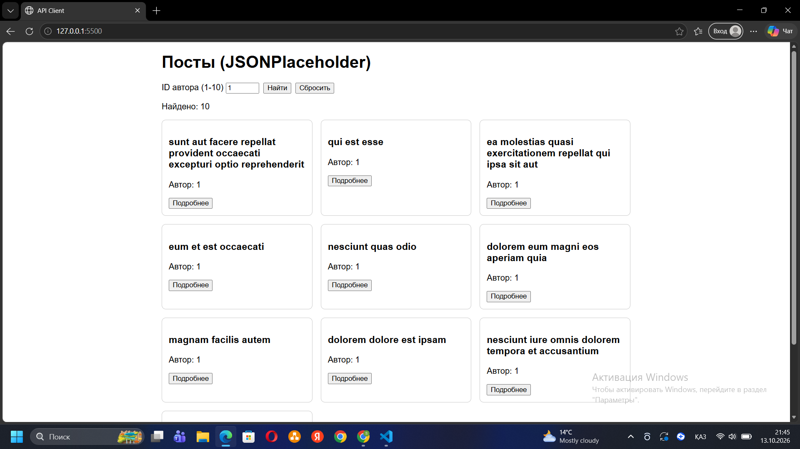

# API Client

## API
JSONPlaceholder, base URL: https://jsonplaceholder.typicode.com

## Как открыть
Через Live Server в VS Code или по ссылке GitHub Pages: <ссылка>

## await и response.ok
Ключевое слово await приостанавливает async-функцию, пока Promise не выполнится, и возвращает его результат, при этом страница не зависает. Я проверяю response.ok, потому что fetch не выбрасывает ошибку на ответы 404 или 500: он считает запрос успешным, если сервер вообще ответил. Без проверки код пытался бы работать с ошибочным ответом как с данными. Если ok равно false, я сам выбрасываю ошибку, и её ловит try/catch и показывает сообщение на странице. Два запроса на странице деталей я делаю через Promise.all, чтобы они шли одновременно, а не по очереди.

## Скриншот

## ИИ
Использовал Claude: объяснение fetch и async/await, примеры кода, помощь с git. Код я проверил и разобрал сам.